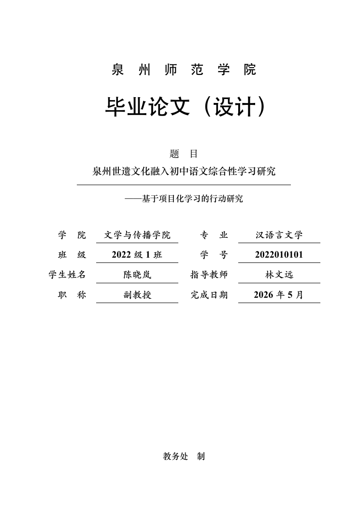

# 泉州师范学院本科毕业论文（设计）LaTeX 模板

> **非官方模板。** 本模板依据泉州师范学院公开的《本科毕业论文（设计）打印格式》（2016 年修订，含封面参考样式）、《本科毕业论文（设计）工作管理规定》以及 2024 年学院实施细则编写。学校、学院和指导教师可能在当年提出新的要求，提交前请务必逐项确认。
>
> 当前版本：`v0.1.0`（2026-11-09）　编译方式：**XeLaTeX + BibTeX**　示例正文：约 1.46 万字



[下载 19 页示例 PDF](docs/qznu-thesis-example.pdf)

## 特性

- 按校方打印格式设置 A4 单面、页边距、页脚居中页码、正文五号宋体、单倍行距、首行缩进两字符。
- 内置封面、中文摘要、英文摘要、目录、正文、参考文献、致谢、附录的完整示例。
- 支持打印格式中给出的 **四种章节编号方案**，通过一个选项切换。
- 图、表、公式均按章编号（图 3-1、表 3-1、式 (4-1)），图表题注位置符合要求。
- 使用 GB/T 7714 顺序编码制参考文献，正文引用以上标方括号显示。
- 目录、书签、交叉引用、PDF 元数据自动生成；字体缺失时提供可移植方案。
- 提供 `make check` 内容检查、`make test` 多方案回归测试和 GitHub Actions 工作流。
- 示例论文包含真实可编译的 TikZ 流程图、pgfplots 柱状图、三线表、公式、访谈资料和附录，可直接替换为你的内容。

## 快速开始

### 1. 环境

需要：

- TeX Live 2024 或更新版本（含 `xelatex`、`ctex`、`gbt7714`、`tikz`、`pgfplots`、`latexmk`）；
- BibTeX（TeX Live 自带）；
- Python 3（仅检查脚本需要）；
- `poppler-utils` 中的 `pdfinfo`、`pdftotext`、`pdffonts`（仅检查脚本需要）。

macOS 推荐安装 MacTeX；Windows 推荐 TeX Live；Linux 可安装 `texlive-full`、`latexmk`、`poppler-utils`。macOS 会自动优先使用 `macnew` 字体集，其他平台由 `ctex` 自动选择；也可以用 `fontset=` 显式指定。

### 2. 编译

```bash
cd qznu-thesis
make            # 生成 build/qznu-thesis.pdf
make view       # 打开 PDF（macOS / Linux）
```

不使用 `make` 时：

```bash
latexmk -xelatex -interaction=nonstopmode -halt-on-error -outdir=build qznu-thesis.tex
```

> 必须使用 XeLaTeX。不要用 pdfLaTeX；模板会在检测到非 XeTeX 时直接报错。

### 3. Overleaf

1. 将整个目录（至少 `qznu-thesis.cls`、`qznu-thesis.tex`、`metadata.tex`、`chapters/`、`refs.bib`）上传为项目；
2. 在 `Menu → Compiler` 中选择 **XeLaTeX**；
3. 将主文件设为 `qznu-thesis.tex`；
4. 如果使用 TeX Live 2023 及更早版本，请把 `fontset` 显式设为 `fandol`，或升级 TeX Live。

## 目录结构

```text
qznu-thesis/
├── qznu-thesis.cls          # 文档类：页面、字体、标题、封面、目录、参考文献
├── qznu-thesis.tex          # 主文件：只负责组织顺序
├── metadata.tex             # 题目、姓名、学院、摘要、关键词等
├── refs.bib                 # 参考文献数据库
├── chapters/
│   ├── 01-introduction.tex
│   ├── 02-theory.tex
│   ├── 03-design.tex
│   ├── 04-results.tex
│   ├── 05-conclusion.tex
│   ├── 99-acknowledgements.tex
│   ├── appendix-a.tex
│   └── appendix-b.tex
├── scripts/
│   ├── build.sh
│   ├── check_content.py     # 题目、摘要、关键词、字数、参考文献检查
│   └── check_pdf.py         # 页面、字体、关键内容、日志、版心检查
├── tests/
│   ├── run_tests.sh         # 四种编号方案 + 选项组合回归测试
│   └── assert_variant.py
├── docs/
│   ├── format-spec.md       # 校方规范与本模板的逐项对应
│   ├── workflow.md          # 从填写到提交的完整流程
│   ├── checklist.md         # 提交前检查清单
│   └── images/
├── Makefile
├── .github/workflows/ci.yml
└── README.md
```

## 填写论文信息

所有个人信息集中在 `metadata.tex`，每行一个命令：

| 命令 | 含义 | 示例 |
|---|---|---|
| `\qznutitle{...}` | 中文题目（建议不超过 20 字） | `泉州世遗文化融入初中语文综合性学习研究` |
| `\qznusubtitle{...}` | 副标题，可留空 | `——基于项目化学习的行动研究` |
| `\qznutitleen{...}` | 英文题目 | `Integrating ...` |
| `\qznucollege{...}` | 学院 | `文学与传播学院` |
| `\qznucollegeen{...}` | 学院英文名 | `School of Literature and Communication` |
| `\qznumajor{...}` | 专业 | `汉语言文学` |
| `\qznumajoren{...}` | 专业英文名 | `Chinese Language and Literature` |
| `\qznuclass{...}` | 班级（封面字段较短） | `2022级1班` |
| `\qznustudentid{...}` | 学号 | `2022010101` |
| `\qznuauthor{...}` | 姓名 | `陈晓岚` |
| `\qznuauthoren{...}` | 姓名拼音 | `CHEN Xiaolan` |
| `\qznuadvisor{...}` | 指导教师 | `林文远` |
| `\qznuadvisoren{...}` | 指导教师拼音 | `LIN Wenyuan` |
| `\qznuadvisortitle{...}` | 职称 | `副教授` |
| `\qznuadvisortitleen{...}` | 职称英文 | `Associate Professor` |
| `\qznudate{...}` | 完成日期 | `2026年5月` |
| `\qznuabstracttext{...}` | 中文摘要，200--300 字 | 见示例 |
| `\qznukeywords{...}` | 中文关键词，用中文分号分隔 | `泉州世界遗产；初中语文；...` |
| `\qznuabstractentext{...}` | 英文摘要 | 见示例 |
| `\qznukeywordsen{...}` | 英文关键词，用英文分号分隔 | `...; ...` |

元数据中的内容会进入封面、摘要页和 PDF 元数据。不要把 `%`、`&`、`#` 等特殊字符直接写入摘要；需要时写成 `\%`、`\&`、`\#`，或把长摘要拆到单独文件并用 `\input` 管理。

## 章节编号方案

学校打印格式允许学院在四种方案中选择一种，但全文必须统一。修改 `qznu-thesis.tex` 第一行：

```latex
\documentclass[scheme=1]{qznu-thesis}
```

| `scheme` | 一级标题 | 二级标题 | 三级标题 | 四级标题 | 适合 |
|---|---|---|---|---|---|
| `1` | `1 绪论` | `1.1 研究背景` | `1.1.1 问题提出` | — | 理工科、需要简洁数字编号 |
| `2` | `一、绪论` | `（一）研究背景` | `1. 问题提出` | `（1）...` | 文科、教育类常用 |
| `3` | `第一章 绪论` | `一、研究背景` | `（一）问题提出` | `1. ...` | 传统文科 |
| `4` | `第一章 绪论` | `1.1 研究背景` | `1.1.1 问题提出` | `1.1.1.1 ...` | 需要“第章 + 多级数字” |

方案 2 的章节标题按规范左缩进两字符；方案 1、3、4 默认居中。若学院要求所有一级标题左对齐，可加：

```latex
\documentclass[scheme=1,chapteralign=left]{qznu-thesis}
```

## 其他选项

| 选项 | 默认 | 说明 |
|---|---|---|
| `scheme=1|2|3|4` | `1` | 章节编号方案 |
| `fontset=macnew|windows|fandol|ubuntu` | 自动 | 传给 `ctex` 的字体集；跨平台 CI 使用 `fandol` |
| `pagenumber=roman|continuous` | `roman` | 前置部分罗马数字、正文阿拉伯数字；或全篇连续阿拉伯数字 |
| `chapteralign=center|left` | `center` | 方案 1/3/4 的一级标题对齐方式；方案 2 固定左对齐 |

## 写作与排版示例

### 新增一章

1. 在 `chapters/` 下新建 `06-discussion.tex`；
2. 在 `qznu-thesis.tex` 的 `\qznumainmatter` 后按顺序 `\input{chapters/06-discussion}`；
3. 章内使用 `\chapter{...}`、`\section{...}`、`\subsection{...}`。

### 插图

```latex
\begin{figure}[htbp]
  \centering
  \includegraphics[width=0.8\textwidth]{figures/your-figure.pdf}
  \caption{图名}
  \label{fig:your-label}
\end{figure}
```

正文中用 `图~\ref{fig:your-label}` 引用。图题自动置于图下方，并按章编号。

### 表格

```latex
\begin{table}[htbp]
  \centering
  \caption{表名}
  \label{tab:your-label}
  \begin{tabularx}{\textwidth}{@{}L{2.5cm}Y@{}}
    \toprule
    项目 & 说明 \\
    \midrule
    ... & ... \\
    \bottomrule
  \end{tabularx}
\end{table}
```

`L{宽度}` 是左对齐定宽列，`Y` 是左对齐弹性列，定义在文档类中。表题自动置于表上方。

### 公式

```latex
\begin{equation}
  \alpha=\frac{k}{k-1}\left(1-\frac{\sum_{i=1}^{k}s_i^2}{s_T^2}\right)
  \label{eq:alpha}
\end{equation}
```

正文中用 `式~\eqref{eq:alpha}` 引用，编号自动为 `(章号-序号)`。

### 参考文献

在 `refs.bib` 中添加条目，在正文中使用 `\cite{key}`。模板已加载 `gbt7714`，引用显示为上标方括号，文末按引用顺序列出。示例数据库包含期刊、专著、标准、电子资源等类型，可作为格式参考。

```latex
据研究，项目化学习强调真实情境与持续探究\cite{xiaxuemei2018}。
```

### 致谢与附录

```latex
\qznuspecialchapter{致谢}          % 不编号，进入目录
\qznuappendix{附录 A　访谈提纲}    % 不编号，表格自动编号为 A-1、A-2...
```

附录中的图、表、公式会自动使用 `A-1`、`B-1` 形式，不会沿用正文章号。

## 格式与内容检查

```bash
make check
```

会依次执行：

1. `scripts/check_content.py`：题目字数、摘要字数、关键词数量、正文汉字数、参考文献条数；
2. `scripts/check_pdf.py`：A4 尺寸、页数、关键内容、中文字体嵌入、日志错误、Overfull hbox、版心尺寸。

示例输出（节选）：

```text
[PASS] 中文题目不超过 20 字     19 字
[PASS] 中文摘要 200--300 字  237 字
[PASS] 正文不少于 8000 字     14600 字
[PASS] 参考文献不少于 10 篇     13 篇
[PASS] 版心宽度 16.5 cm             469.47pt
[PASS] 版心高度 25.7 cm             731.24pt
```

理工科或艺术、体育类专业可按学校下限调整：

```bash
python3 scripts/check_content.py --min-body 6000
```

检查脚本是辅助工具，不能替代指导教师、学院教学秘书和查重系统的审查。

## 回归测试

```bash
make test
```

测试内容：

- 主文档完整编译；
- `scheme=1/2/3/4` 四种方案分别编译，并检查一级标题、目录、图 3-1、表 3-1、公式 (4-1)、表 B-1；
- `pagenumber=continuous` 与 `chapteralign=left` 选项组合；
- 内容检查与 PDF 检查。

测试使用 `fontset=fandol` 编译变体，以便在 macOS、Linux、Windows 上得到可复现的结果。`build/tests/` 下会保留各方案 PDF，便于比较。

## 与学校规范的对应

| 校方要求 | 模板实现 |
|---|---|
| A4 单面打印 | `geometry` 设置 A4；PDF 为 A4，单面打印由打印机设置控制 |
| 上/下/左/右 2.0 cm，左侧装订线 0.5 cm | 版心左边界 2.5 cm、右边界 2.0 cm；版心 16.5 × 25.7 cm |
| 页脚 1 cm，页码居中 | `footskip=1cm`，`fancyhdr` 页脚居中 |
| 论文题目小二黑体加粗居中 | `\zihao{-2}` + `\heiti` + `\bfseries` |
| 副标题四号黑体 | 四号黑体，居中 |
| 学院、专业、学号、姓名、指导教师、职称小四楷体加粗 | 摘要页元数据行使用 `\zihao{-4}\kaishu\bfseries` |
| 中文摘要小五楷体加粗，标签小五黑体加粗 | `qznuabstract` 环境按此设置 |
| 英文摘要五号 Times New Roman | `qznuabstracten` 环境按此设置 |
| 目录五号，章标题黑体、节标题宋体，点线连接页码 | `titletoc` 设置 |
| 正文五号宋体，英文 Times New Roman，单倍行距 | 文档类基础字号 `zihao=5`，`\linespread{1.0}` |
| 首行缩进两字符 | `\parindent=2\ccwd` |
| 四种章节编号任选一种、全文统一 | `scheme=1/2/3/4` |
| 图、表按章编号，图题在下、表题在上 | `\counterwithin` + `caption` 设置 |
| 公式按章编号，编号右对齐 | `equation` 环境，`\theequation` 为“章-序号” |
| 参考文献五号，正文引用上标方括号 | `gbt7714` + `\cite`，文献表五号 |
| 中文题目一般不超过 20 字；摘要 200--300 字；关键词 3--5 个；参考文献 10 篇以上 | 由 `check_content.py` 检查 |
| 文科 8000 字以上，理科/艺术/体育 6000 字以上 | 默认检查 8000 字，可用 `--min-body 6000` 调整 |

更细的逐项说明、原文依据和差异见 [格式规范对照](docs/format-spec.md)；从填写到打印的步骤见 [工作流](docs/workflow.md)；提交前逐项打勾见 [检查清单](docs/checklist.md)。

## 重要说明与已知差异

1. **不是学校官方模板。** 学校只提供了 Word 格式规范，未授权本模板。格式审查以学院当年要求为准。
2. **规范版本。** 截至 2026-11-09 检索，学校官网可下载的《毕业论文（设计）打印格式》为 **2016 年修订版**（含封面参考样式）；2022 年管理规定和 2024 年学院实施细则主要补充了过程管理、查重、答辩和字数要求，未给出新的字号、行距、页边距表。本模板以 2016 年版式为准，并交叉核对后续内容要求。
3. **英文摘要位置。** 2016 年打印格式的“打印顺序”把“英文翻译（含题目、个人信息、摘要、关键词）”列在参考文献之后；不少学院实际要求英文摘要紧随中文摘要。本示例默认把英文摘要放在中文摘要之后、目录之前。若学院要求严格按 2016 顺序，把 `qznu-thesis.tex` 中的 `\makeabstracten` 移到 `\qznubibliography{refs}` 之后即可。
4. **页码。** 规范只要求“插入页码，居中”，未说明前置部分是否用罗马数字。模板默认封面不编号、摘要/目录用罗马数字、正文从 1 开始；如学院要求全篇连续阿拉伯数字，使用 `pagenumber=continuous`。
5. **一级标题对齐。** 规范只对方案 2 明确“左缩进 2 个汉字字符”，未明确方案 1/3/4 是否居中。模板默认居中，可用 `chapteralign=left` 改为左对齐；提交前以学院模板为准。
6. **封面。** 封面按 2016 年参考样式重排，保留学院、专业、班级、学号、姓名、指导教师、职称、完成日期和“教务处 制”。如学院有固定封面（含校徽、校名图片），请以学院文件替换 `\makecover`。
7. **示例数据。** 示例论文中的人物、学校、问卷数据、访谈语句、统计结果均为排版演示用虚构材料，不是真实研究数据；参考文献的版本信息请在正式提交前逐条核对。
8. **字体。** macOS 自动使用 `macnew`（宋体 SC、黑体 SC、楷体 SC）；Windows 使用系统宋体/黑体/楷体；Linux/CI 使用 Fandol。不同字体的字面宽度略有差异，换行位置可能不同，但字号、行距、版心不变。Fandol 字体不含“蟳”字，示例中写作常见的“浔埔”；如必须使用“蟳埔”，请换用包含该字的字体，或把该词改为图片。最终提交前应在自己学校/打印店的电脑上再编译一次。
9. **参考文献格式。** `gbt7714` 输出 GB/T 7714 顺序编码制，部分标点与学校 2016 年示例中的中文标点略有差异；如学院有更细的著录要求，可在 `refs.bib` 中调整字段，或改用学院指定的 `.bst`。

## 参考来源

校方文件（检索日期：2026-11-09）：

- [泉州师范学院本科毕业论文（设计）打印格式（2016 年修订，含封面参考样式）](https://www.qztc.edu.cn/sjxy/2016/1013/c1981a143269/page.htm)
- [泉州师范学院本科毕业论文（设计）工作管理规定](https://www.qztc.edu.cn/jwc/2015/0701/c1037a37010/page.htm)
- [泉州师范学院外国语学院毕业论文（设计）工作实施细则（试行）（2024）](https://www.qztc.edu.cn/wgyxy/2024/0507/c178a274052/page.htm)
- [泉州师范学院教务处《关于做好 2019 届本科毕业生教育实习和毕业论文（设计）工作的通知》](https://www.qztc.edu.cn/_upload/article/files/a9/ff/ce67f50b4d34931f8d68603bbf4a/ac05b873-05be-49d4-afa7-5cfe51f6dcf1.pdf)

开源高校论文模板（仅借鉴工程结构与交互方式，未复制代码）：

- [CQUThesis（重庆大学）](https://github.com/nanmu42/CQUThesis)：文档类/示例分离、latexmk 多平台构建、持续集成。
- [HUSTPaperTemp（华中科技大学）](https://github.com/skinaze/HUSTPaperTemp)：封面与正文分离、示例与说明文档并重。
- [SZTU-Thesis-LaTeX-Template（深圳技术大学）](https://github.com/SZTU-ACM/SZTU-Thesis-Latex-Template)：按学校最新 Word 范例逐项实现、内容目录组织。
- [xmu-template（厦门大学）](https://github.com/F5Soft/xmu-template)：封面字段接口、字体与页眉页脚处理。
- [NJUBachelor（南京大学）](https://github.com/ZLCao/NJUBachelor)：本科论文类文件组织与参考文献处理。

## 许可

本模板代码以 MIT License 发布，见 [LICENSE](LICENSE)。学校名称、规范文本及相关文件的版权归原权利人所有；本模板不声称获得泉州师范学院官方认可。
